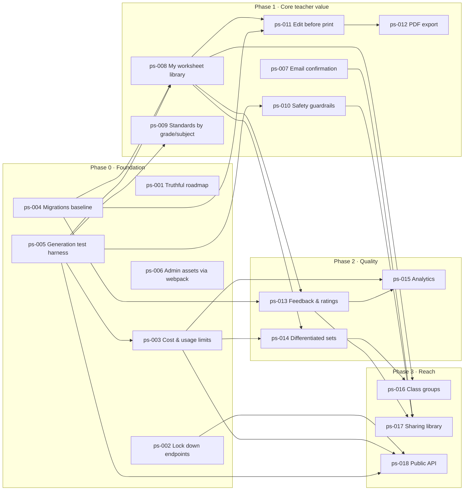

# TeachSpark Roadmap

> **Last updated:** 2026-11-02 · **Baseline:** `main` at `0530dc2` (after PR #15) · **Owner:** Lead maintainer
>
> This file is the source of truth for where TeachSpark is going. The public `/Home/Plan` page should
> reflect it (see [ps-001](specs/ps-001-truthful-roadmap-page.md)), not the other way round.

## Vision

**A teacher can go from "I need a worksheet on this standard" to a classroom-ready, printable,
trustworthy worksheet in under two minutes, and can find, reuse and improve it later.**

Three principles shape every item below:

1. **Teachers stay in control of the AI.** Generated content is a draft the teacher reviews, edits
   and owns, never a black box.
2. **Safe and affordable by default.** Open registration plus a paid LLM means cost limits, abuse
   limits and student-appropriate output must exist before growth features.
3. **No student data.** TeachSpark serves teachers. Features are designed so the app never needs to
   store student names or records (keeps FERPA/COPPA exposure at zero).

## Where we are (verified 2026-11-02)

What actually works today, checked against the code rather than the public roadmap page:

| Area | State | Evidence |
|------|-------|----------|
| AI worksheet generation | ✅ Works (OpenAI via Microsoft.Extensions.AI) | `Services/Implementations/OpenAILlmService.cs`, `WorksheetGeneratorController.Create` |
| Accounts | ✅ Register/login; ⚠️ no email confirmation or email sender | `Program.cs` (no `RequireConfirmedAccount`, no `IEmailSender`) |
| Admin area | ✅ CRUD for standards, Bloom levels, templates, worksheets, exports, API keys; restricted to `Admin` role (PR #14) | `Areas/Admin`, `.knowledge/architecture/admin-authorization.md` |
| Standards | ⚠️ ~3,000 rows imported (CCSS ELA, CCSS Math, Colorado 2020 R/W) but the generator only offers **grade 8 ELA** | `WorksheetGeneratorController.cs:324-325` |
| Print | ⚠️ Browser print + "student version" toggle; no PDF, no answer-key layout | `Views/WorksheetGenerator/Display.cshtml` |
| Teacher's own worksheets | ❌ No "my worksheets" list; dashboard only links to "New worksheet" | `Views/Account/Dashboard.cshtml` |
| Cost control | ❌ `DailyCostLimit` is configured but **never enforced** | only `Configuration/LlmConfiguration.cs:21` reads it |
| Favorites / sharing | ❌ `IsFavorite` / `IsPublic` columns exist, editable only by admins | `Data/Entities/Worksheet.cs:46-48` |
| Public API | ❌ `ApiKey` entity and admin screens exist, but nothing authenticates with them; the model API is anonymous | `Controllers/ModelsController.cs` (audit AUTH2) |
| Schema management | ⚠️ `EnsureCreated()` at startup while a `Migrations/` folder exists, so migrations are not applied | `Program.cs:80` |
| Tests | ⚠️ 15 integration tests (routing, admin auth, identity pages); generation flow untested | `TeachSpark.Tests/` |
| Frontend pipeline | ⚠️ Public site fully on webpack; admin layout still loads 13 CDN assets | audit FE1 |

**The public roadmap page overstates progress.** It lists "Student Cohort Management", "REST API
Endpoints" and "Teacher Feedback Loop" as *In Progress* (none exist in code), "daily cost limits" and
"rate limiting" as live (not enforced), and an "indigo/amber" palette replaced by PR #14. Fixing that
is the first item.

## Roadmap at a glance

Phases are sequential in intent; items within a phase can run in parallel where dependencies allow.
Sizes: **S** ≈ 1–2 days, **M** ≈ 3–5 days, **L** ≈ 1–2 weeks.

### Phase 0 — Foundation & trust (Now)

*Exit criteria: nothing anonymous can spend money or reach internals; spend is capped; schema changes
are safe; generation can be tested without calling OpenAI.*

| ID | Item | Size | Depends on | Status |
|----|------|------|-----------|--------|
| [ps-001](specs/ps-001-truthful-roadmap-page.md) | Truthful public roadmap page | S | — | done |
| [ps-002](specs/ps-002-lock-down-model-and-diagnostics-endpoints.md) | Lock down model API and diagnostics | S | — | proposed |
| [ps-003](specs/ps-003-enforce-ai-cost-and-usage-limits.md) | Enforce AI cost and usage limits | M | ps-005 | proposed |
| [ps-004](specs/ps-004-ef-core-migrations-baseline.md) | EF Core migrations baseline | M | — | proposed |
| [ps-005](specs/ps-005-generation-flow-test-harness.md) | Generation-flow test harness | M | — | proposed |
| [ps-006](specs/ps-006-admin-assets-via-webpack.md) | Admin assets through webpack | S | — | proposed |

### Phase 1 — Core teacher value (Next)

*Exit criteria: a teacher can pick any supported grade and subject, generate, review, edit, print a
clean PDF with answer key, and find it again later. Accounts are tied to verified emails.*

| ID | Item | Size | Depends on | Status |
|----|------|------|-----------|--------|
| [ps-007](specs/ps-007-account-trust-email-confirmation.md) | Email confirmation and password reset | M | — | proposed |
| [ps-008](specs/ps-008-my-worksheet-library.md) | My worksheet library | M | ps-004, ps-005 | proposed |
| [ps-009](specs/ps-009-standards-by-grade-and-subject.md) | Standards by grade and subject | M | ps-005 | proposed |
| [ps-010](specs/ps-010-student-safe-generation-guardrails.md) | Student-safe generation guardrails | M | ps-005 | proposed |
| [ps-011](specs/ps-011-review-and-edit-before-print.md) | Review and edit before print | M | ps-004, ps-008 | proposed |
| [ps-012](specs/ps-012-classroom-ready-pdf-export.md) | Classroom-ready PDF export | M | ps-011 | proposed |

### Phase 2 — Quality & differentiation (Later)

*Exit criteria: teachers can tell us what worked, generate leveled versions in one step, and we can
see cost and quality per worksheet type.*

| ID | Item | Size | Depends on | Status |
|----|------|------|-----------|--------|
| [ps-013](specs/ps-013-teacher-feedback-and-ratings.md) | Teacher feedback and ratings | M | ps-004, ps-008 | proposed |
| [ps-014](specs/ps-014-differentiated-worksheet-sets.md) | Differentiated worksheet sets | M | ps-003, ps-008 | proposed |
| [ps-015](specs/ps-015-usage-and-quality-analytics.md) | Usage, cost and quality analytics | M | ps-003, ps-013 | proposed |

### Phase 3 — Classroom & reach (Horizon)

*Exit criteria: teachers can organise work by class, share good worksheets, and integrate
programmatically, all without TeachSpark holding student data.*

| ID | Item | Size | Depends on | Status |
|----|------|------|-----------|--------|
| [ps-016](specs/ps-016-class-groups.md) | Class groups (no student data) | M | ps-008, ps-014 | proposed |
| [ps-017](specs/ps-017-sharing-and-community-library.md) | Sharing and community library | L | ps-007, ps-010, ps-013 | proposed |
| [ps-018](specs/ps-018-public-worksheet-api.md) | Public worksheet API | L | ps-002, ps-003, ps-005 | proposed |

## Dependency map

## Why this order

- **Safety and cost before growth.** Registration is open and every generation spends real money.
  The unenforced `DailyCostLimit` (ps-003) and anonymous model API (ps-002) are the cheapest ways for
  the project to get hurt, so they come first.
- **Migrations before features.** Six of the next twelve items change the schema. With `EnsureCreated`
  an existing database never receives new columns, so ps-004 unblocks almost everything after it.
- **A test seam before touching generation.** ps-005 lets the generation flow run against a fake LLM.
  Every item that changes generation (limits, standards, guardrails, differentiation, API) depends on it,
  which also satisfies constitution principle I.
- **Finish the core loop before adding breadth.** Generate → review/edit → print → find again (ps-008
  to ps-012) is what makes a teacher come back. Cohorts, sharing and an API only matter once that loop
  is solid.
- **Feedback before analytics and sharing.** Ratings (ps-013) give the quality signal that analytics
  (ps-015) report on and that a shared library (ps-017) needs to rank content.
- **Cohorts without student data.** The page's "Student Cohort Management" is reframed as teacher-owned
  class groups (ps-016) that carry grade level and differentiation preferences, not student records.

## Not on the roadmap (deliberately)

- **Model fine-tuning.** The page mentions "model fine-tuning priorities". Prompt and template
  improvement driven by ratings (ps-013) gets most of the value at a fraction of the cost and risk.
- **Student accounts or student-facing delivery.** Conflicts with the no-student-data principle.
- **LMS integrations** (Google Classroom, Canvas). Revisit after ps-018 proves the API.
- **Switching off SQLite.** Fine at current scale; revisit if ps-015 shows concurrency or size pressure.

## Open questions

1. **Who pays for generation?** Free with quotas, or paid tiers? Affects ps-003 limits and ps-018.
2. **Email provider** for ps-007 (e.g. SendGrid, Azure Communication Services, SMTP).
3. **Subject scope:** ELA only, or ELA + Math (Math standards are already imported)? ps-009 assumes both.
4. **Which state frameworks** beyond CCSS and Colorado 2020 matter to target teachers?
5. **Release versioning.** No tags exist today. Proposal: tag `v0.1.0` at the PR #14 merge and a minor
   version at each phase exit.

## How to use and track this roadmap

**Status values** (kept identical in each spec's frontmatter and the tables above):

| Status | Meaning |
|--------|---------|
| `proposed` | Prospective spec written; not yet committed to |
| `ready` | Dependencies met, open questions answered; next to pick up |
| `specifying` | `/devspark-specify` run; real spec exists (link it in the ps file's `spec:` field) |
| `in-progress` | Implementation underway on a branch |
| `done` | Merged; record the PR in the ps file's `delivered_in:` field |
| `deferred` / `dropped` | Parked or abandoned; give the reason in the changelog |

**Workflow for an item:**

1. Pick the lowest-numbered `ready` item whose `depends_on` are all `done`.
2. Run `/devspark-specify` and paste the ps file's *Intake* section as the input. It follows DevSpark's
   intake template (verified findings, goal, design, non-goals, acceptance criteria, rollout).
3. Set `status: specifying` and the `spec:` link; move to `in-progress` when a branch exists.
4. On merge set `status: done`, `delivered_in: PR #n`, and add a changelog line below.
5. Update the public page whenever a status changes: edit the `live` and `phases` arrays at the top of `TeachSpark.Web/Views/Home/Plan.cshtml`, and check the home page (`Views/Home/Index.cshtml`) still makes no claim the code does not support. `TeachSpark.Tests/PublicPagesTests.cs` guards the known false claims.

**Review cadence:** re-verify the "Where we are" table and re-order at each phase exit or monthly,
whichever comes first; run `/devspark-site-audit` at each phase exit and compare with the 2026-11-01
baseline.

## Changelog

| Date | Change |
|------|--------|
| 2026-11-02 | Roadmap created from code review, the 2026-11-01 site audit, the PR #14 review and the public `/Home/Plan` page. 18 prospective specs, all `proposed`. |
| 2026-11-02 | ps-001 → `in-progress` on branch `feat/truthful-roadmap-page`: roadmap page rebuilt from this file (Live / Now / Next / Later / Horizon); home and generator landing copy corrected (5 formats, optional answer key, grade 8 standards, no prompt editing, sharing or download claims); `PublicPagesTests` added. |
| 2026-11-02 | ps-001 → `done`: merged in PR #16 (`189cd6e`). Next up in Phase 0: ps-002, ps-004, ps-005 and ps-006 have no dependencies and can start in parallel; ps-003 follows ps-005. |
